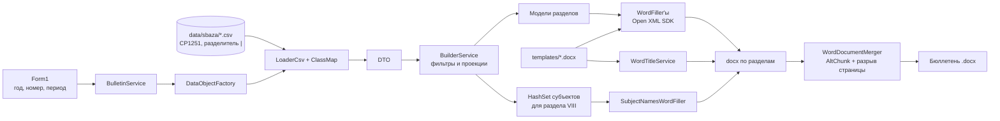

# Brainstable.Applications

Настольное приложение для автоматической сборки **«Официального бюллетеня» ФГБУ «Госсорткомиссия»** из выгрузки базы данных SBAZA.

По заданному выпуску (год, номер, период дат) программа читает CSV-выгрузку, формирует документы Word по разделам бюллетеня (таблицы I.1 – VIII.1), склеивает их в один `.docx` и открывает папку с результатом.

- Платформа: Windows, .NET 10 (`net10.0-windows`), WinForms
- Язык: C# (nullable, implicit usings, collection expressions)
- Ключевые библиотеки: CsvHelper 33.1.0, DocumentFormat.OpenXml 3.2.0 (Open XML SDK)
- Интерфейс: одно окно `Form1` — год, номер, период дат, кнопка «Сформировать»

---

## Содержание

- [Возможности](#возможности)
- [Требования](#требования)
- [Быстрый старт](#быстрый-старт)
- [Входные данные](#входные-данные)
- [Шаблоны Word](#шаблоны-word)
- [Результат](#результат)
- [Архитектура](#архитектура)
- [Правила отбора данных](#правила-отбора-данных)
- [Как добавить новый раздел](#как-добавить-новый-раздел)
- [Известные особенности и ограничения](#известные-особенности-и-ограничения)
- [Лицензия](#лицензия)

---

## Возможности

- Генерация 16 документов: титул с содержанием и 15 таблиц разделов.
- Трёхуровневая группировка строк: **блок реестра → род/вид (рус. + лат.) → сорт**.
- Единое оформление: Times New Roman, жирные заголовки блоков, подчёркнутые названия сортов, курсивные селекционные номера, таблицы без видимых границ.
- Подстановка реквизитов выпуска в титул (`[year]`, `[num]`, `[n_year]`), включая колонтитулы и плейсхолдеры, разбитые Word на несколько `Run`.
- Склейка всех разделов в один файл с разрывом страницы перед каждым разделом.
- Очистка папки выпуска перед генерацией и пропуск разделов без данных (кроме справочных II.5 и VIII.1).
- Автоматическое открытие папки с результатом в Проводнике.

## Требования

| Компонент | Версия / примечание |
|---|---|
| ОС | Windows 10/11 (приложение использует WinForms и `Environment.SpecialFolder.MyDocuments`) |
| .NET SDK | 10.0 — для сборки |
| .NET Desktop Runtime | 10.0 — для запуска готового exe |
| Microsoft Word | не требуется для генерации; нужен для просмотра результата (склейка выполнена через `AltChunk`) |
| Выгрузка SBAZA | папка `data/sbaza` с CSV-файлами (см. ниже) — **в репозитории отсутствует** |

## Быстрый старт

```powershell
# из корня репозитория
dotnet build Brainstable.Applications.slnx

# запуск (рабочая директория — текущая папка консоли)
dotnet run --project Brainstable.Applications/Brainstable.Applications.csproj
```

Либо открыть `Brainstable.Applications.slnx` в Visual Studio 2022 (17.14+) / Rider и запустить `Brainstable.Applications` (F5).

Порядок работы:

1. Скопировать выгрузку БД в `data\SBAZA` рядом с исполняемым файлом
   (`Brainstable.Applications\bin\Debug\net10.0-windows\data\SBAZA`).
2. Запустить приложение.
3. Заполнить поля:
   - **Год** — например `2025`;
   - **Номер №** — номер выпуска в году, например `5`;
   - **Номер за все время** — сквозной номер, например `304`;
   - **Начальная дата (>)** и **Конечная дата (<=)** — период выпуска.
4. Нажать **«Сформировать»**.

> **Важно:** пути `templates\` и `data\sbaza\` ищутся относительно **текущей рабочей директории**, а не папки сборки.
> При запуске из Visual Studio это каталог проекта, при запуске exe из Проводника — папка exe. Шаблоны копируются в выходную папку при сборке, а выгрузку нужно положить самостоятельно.
>
> Если конечная дата не больше начальной, выводится предупреждение и генерация не запускается.

## Входные данные

### Формат CSV

- Кодировка — **Windows-1251** (`Encoding.GetEncoding(1251)`, регистрируется `CodePagesEncodingProvider`).
- Разделитель — `|`.
- Первая строка — заголовки.
- Чтение «терпимое»: отсутствующие поля и заголовки, а также битые строки не прерывают загрузку (`MissingFieldFound = null`, `HeaderValidated = null`, `BadDataFound = null`).

### Используемые файлы

Приложение читает только 13 таблиц выгрузки (остальные ~180 файлов SBAZA игнорируются).

| Файл | Назначение | Читаемые колонки |
|---|---|---|
| `ЗАЯВКА.csv` | заявки | `Н_ЗАЯВКИ`, `К_СОРТА`, `Н_ТИПА_ЗАЯВКИ`, `ДАТА_РЕГИСТРАЦИИ`, `ДАТА_ОТКЛОНЕНИЯ`, `Н_ПРИЧ_ОТКЛОНЕНИЯ`, `ДАТА_ЭКСПЕРТИЗЫ`, `Н_СУБЪЕКТА_П`, `ДАТА_ВКЛЮЧЕНИЯ`, `Н_ПРИЧ_К_ОХР_ДОП` |
| `СОРТ.csv` | сорта | `К_СОРТА`, `И_СОРТА`, `Н_РОДА`, `И_СОРТА_ЛАТ`, `Н_СЕЛЕКЦИОННЫЙ` |
| `РОД.csv` | роды/виды | `Н_РОДА`, `И_РОДА`, `И_РОДА_ЛАТ`, `Н_БЛОКА_РЕЕСТРА`, `Н_БЛОКА_КЛАССОВ` |
| `БЛОК_РЕЕСТРА.csv` | блоки реестра | `Н_БЛОКА_РЕЕСТРА`, `И_БЛОКА_РЕЕСТРА`, `Н_ПОРЯДКОВЫЙ` (по индексам 0–2) |
| `БЛОК_КЛАССОВ.csv` | блоки классов | `Н_БЛОКА_КЛАССОВ`, `И_БЛОКА_КЛАССОВ` |
| `ЗАЯВКА_ЗАЯВИТЕЛЬ.csv` | заявители заявки | `Н_ЗАЯВКИ`, `Н_СУБЪЕКТА`, `ПРИОРИТЕТ` |
| `СОРТ_АВТОР.csv` | авторы сорта | `К_СОРТА`, `Н_СУБЪЕКТА` |
| `СОРТ_СИНОНИМ.csv` | прежние/одобренные названия | `К_СОРТА`, `И_СОРТА`, `ДАТА_ИЗМЕНЕНИЯ`, `ДАТА_ОДОБРЕНИЯ` |
| `СОРТ_ПАТЕНТ.csv` | патенты | `К_СОРТА`, `ДАТА_Н_ОХРАНЫ`, `Н_ПАТЕНТА`, `ДАТА_К_ОХРАНЫ`, `CALC_END_DATE` |
| `АРХИВ_СД.csv` | изменения состава субъектов | `Н_ЗАЯВКИ`, `Н_ТИПА_ЗАЯВКИ`, `К_СОРТА`, `Н_СУБ_СТАРЫЙ`, `ТИП_СУБЪЕКТА`, `П_ИЗМЕНЕНИЯ`, `ДАТА_ИЗМЕНЕНИЯ`, `Н_СУБ_НОВЫЙ` |
| `СУБЪЕКТ.csv` | субъекты | `Н_СУБЪЕКТА`, `И_СУБЪЕКТА`, `ИНН`, `СНИЛС` (по индексам 0, 1, 10, 11) |
| `ЛИЦЕНЗИЯ.csv` | лицензии | `Н_ЗАЯВКИ`, `Н_ПАТЕНТА`, `Н_СУБЪЕКТА`, `ДАТА_РЕГИСТРАЦИИ`, `Н_ЛИЦЕНЗИИ`, `ВИД`, `К_СОРТА`, `ДАТА_АННУЛИРОВАНИЯ`, `ДАТА_К_ДЕЙСТВИЯ`, `ВЕРСИЯ` |
| `ДОГОВОР.csv` | договоры (передача права) | `Н_ЗАЯВКИ`, `Н_ПАТЕНТА`, `К_СОРТА`, `ДАТА_РЕГИСТРАЦИИ`, `ВИД`, `Н_ДОГОВОРА`, `УСЛОВИЯ`, `КТО`, `КОМУ`, `ДАТА_АННУЛИРОВАНИЯ`, `ДАТА_К_ДЕЙСТВИЯ` |

Соответствие «колонка CSV → свойство DTO» задаётся классами `ClassMap` в `Infrastructure/CsvHelper`, имена файлов — константами `DataFileNames` в `Services/Implementations/DataObjectFactory.cs`.

Особый случай — **`СОРТ_СИНОНИМ.csv`**: строки бывают с 6 и с 8 колонками, поэтому файл разбирается вручную (`LoaderCsv.LoadVarietyNameApprovedDtos`), без CsvHelper; заголовок пропускается, поддерживаются форматы дат `yyyy-M-d` и `yyyy-MM-dd`.

## Шаблоны Word

Шаблоны лежат в `Brainstable.Applications/templates/` и копируются в выходную папку при сборке (`CopyToOutputDirectory=PreserveNewest`).

Каждый шаблон **уже содержит** заголовок раздела (рус./англ.) и шапку таблицы. Код дописывает в конец документа заголовки блоков/видов и строки данных. Поэтому при изменении состава или порядка колонок нужно синхронно править и `.docx`-шаблон, и соответствующий заполнитель.

| Шаблон | Раздел бюллетеня | Заполнитель |
|---|---|---|
| `0. Титул.docx` | титул и содержание | `WordTitleService` |
| `1.1 Заявки на выдачу патента.docx` | I, табл. I.1 | `AcceptedApplicationWordFiller` |
| `2.1 Предложенные названия.docx` | II, табл. II.1 | `ProposedNamesWordFiller` |
| `2.2 Одобренные названия.docx` | II, табл. II.2 | `ApprovedNamesWordFiller` |
| `2.3 Предложения по изменению одобренных названий.docx` | II, табл. II.3 | `ProposalsChangeApprovedNamesWordFiller` |
| `2.4 Одобренные изменения названий.docx` | II, табл. II.4 | `ApprovedChangeApprovedNamesWordFiller` |
| `2.5 Сводная таблица предложенных названий.docx` | II, табл. II.5 | `BlockClassVarietyNamesWordFiller` |
| `3.1 Отозванные заявки.docx` | III, табл. III.1 | `WithdrawnApplicationWordFiller` |
| `4.5 Сорта и гибриды, включенные в реестр охраняемых.docx` | IV, табл. IV.1 | `DecisionsApplicationWordFiller` |
| `4.6 Отклоненные заявки на выдачу патента.docx` | IV, табл. IV.2 | `RejectionApplicationWordFiller` |
| `5.1 Изменения состава субъектов селекционных достижений.docx` | V, табл. V.1 | `SubjectChangedWordFiller` |
| `6.1 Окончание охраны.docx` | VI, табл. VI.1 | `ProtectionEndApplicationWordFiller` |
| `7.1 Зарегистрированные лицензии.docx` | VII, табл. VII.1 | `LicencesWordFiller` |
| `7.2 Аннулированные лицензии.docx` | VII, табл. VII.2 | `LicencesCanceledWordFiller` |
| `7.4 Передача права.docx` | VII, табл. VII.3 | `LicencesTransferWordFiller` |
| `8. Субъекты.docx` | VIII, табл. VIII.1 | `SubjectNamesWordFiller` |

> Номера в именах файлов не совпадают с номерами таблиц: `4.5` → IV.1, `4.6` → IV.2, `7.4` → VII.3. Это историческая нумерация, менять имена без правки `BulletinService` нельзя.

Плейсхолдеры титула:

| Плейсхолдер | Значение | Поле формы |
|---|---|---|
| `[year]` | год выпуска | Год |
| `[n_year]` | номер выпуска в году | Номер № |
| `[num]` | сквозной номер | Номер за все время |

`WordTitleService` заменяет текст на уровне абзаца: если Word разбил `[num]` на несколько `Run`, замена всё равно сработает, а форматирование первого `Run` сохранится. Обрабатываются тело документа, таблицы, колонтитулы.

## Результат

Генерация выполняется в `BulletinService.BuilderBulletin()`:

1. `DataObjectFactory` + `LoaderCsv` загружают CSV.
2. `BuilderService` строит модели разделов.
3. Заполнители создают по одному `.docx` на раздел.
4. `WordDocumentMerger` склеивает файлы в один документ.

Куда сохраняется:

```
%USERPROFILE%\Documents\Бюллетени\
├─ 2025-304\                                  # {Год}-{сквозной номер}
│  ├─ 0. Титул.docx
│  ├─ 1.1 Заявки на выдачу патента.docx
│  ├─ ...
│  └─ 8. Субъекты.docx
└─ Бюллетень 2025-5(304).docx                 # {Год}-{номер в году}({сквозной})
```

- Папка выпуска **очищается** перед генерацией (файлы и подпапки).
- Разделы без данных не создаются; исключения — справочные II.5 и VIII.1, они формируются всегда.
- Итоговый файл собирается из файлов папки в алфавитном порядке (порядок имён совпадает с порядком разделов).
- Склейка реализована через `AltChunk` + разрыв страницы: Word объединяет части при открытии. Сторонние редакторы (например, LibreOffice) могут отображать вставленные части некорректно.
- При успехе показывается сообщение и открывается Проводник; при ошибке склейки — предупреждение «не сформирован» (детали исключения не показываются).

## Архитектура

### Слои

| Слой | Каталог | Ответственность |
|---|---|---|
| UI | `Form1.cs`, `Form1.Designer.cs` | ввод реквизитов выпуска, запуск генерации |
| Оркестрация | `Services/Implementations/BulletinService.cs` | порядок разделов, имена файлов, очистка, склейка, сообщения |
| Выборки | `Services/Implementations/BuilderService.cs` | фильтрация и проекция DTO в модели разделов, накопление списка субъектов |
| Доступ к данным | `Dto/`, `Infrastructure/CsvHelper/`, `Infrastructure/Reader/LoaderCsv.cs`, `Services/Implementations/DataObjectFactory.cs` | чтение CSV и преобразование в DTO |
| Модели | `Models/` | доменные модели строк разделов (сорт, блок, род, даты, субъекты) |
| Генерация Word | `Services/*WordFiller.cs`, `WordTemplateFillerBase.cs`, `WordTitleService.cs` | заполнение шаблонов через Open XML SDK |
| Склейка | `Services/WordDocumentMerger.cs` | объединение документов в один `.docx` |

### Структура каталогов

```
Brainstable.Applications/                    # корень репозитория
├─ Brainstable.Applications.slnx             # решение (новый XML-формат)
├─ .gitignore, .gitattributes
└─ Brainstable.Applications/                 # проект
   ├─ Brainstable.Applications.csproj        # net10.0-windows, WinExe
   ├─ Program.cs                             # ApplicationConfiguration + Form1
   ├─ Form1.cs / Form1.Designer.cs / Form1.resx
   ├─ Dto/                                   # 13 DTO под CSV-таблицы
   ├─ Infrastructure/
   │  ├─ CsvHelper/                          # 13 ClassMap: заголовки CSV → свойства
   │  └─ Reader/LoaderCsv.cs                 # чтение CP1251, разделитель "|"
   ├─ Models/                                # модели разделов + Bulletin
   ├─ Services/
   │  ├─ Implementations/
   │  │  ├─ BulletinService.cs               # точка входа генерации выпуска
   │  │  ├─ BuilderService.cs                # выборки разделов
   │  │  └─ DataObjectFactory.cs             # CSV → DTO, имена файлов
   │  ├─ Interfaces/IDataObjectFactory.cs
   │  ├─ WordTemplateFillerBase.cs           # базовая генерация таблиц
   │  ├─ WordTitleService.cs                 # титул, плейсхолдеры
   │  ├─ WordDocumentMerger.cs               # склейка docx
   │  └─ *WordFiller.cs                      # 15 заполнителей разделов
   └─ templates/                             # 16 .docx-шаблонов
```

### Поток данных



### Базовый класс заполнения

Большинство разделов реализованы через `WordTemplateFillerBase<T>` (шаблонный метод). Наследник переопределяет:

| Метод | Назначение |
|---|---|
| `GroupItems` | группировка верхнего уровня (блок реестра), сортировка по `BlockOrderNumber` |
| `GetGroupHeader` | заголовок блока |
| `GetSubGroups` | группировка внутри блока (род/вид), сортировка по названию |
| `GetSubGroupHeader` | заголовок вида: русское + латинское название |
| `GetDataItems` | строки таблицы и их порядок |
| `GetTableColumns` | описание колонок: имя, ширина в %, заголовок |
| `GetCellData` | значения ячеек (список строк → несколько строк в ячейке) |
| `GetCellFormatting` | жирный/курсив/подчёркивание, размер шрифта, выравнивание, форматирование отдельных строк ячейки |

Базовый класс создаёт параграфы и таблицы без границ, шрифт Times New Roman, размеры 10/12/14 pt (`FontSizeSmall/Normal/Large` = `20/24/28` в half-points).

Два заполнителя не наследуют базовый класс, так как имеют собственную вёрстку: `SubjectNamesWordFiller` (нумерация субъектов в две колонки) и `BlockClassVarietyNamesWordFiller` (сводная таблица «блок классов — перечень названий»).

## Правила отбора данных

Все интервалы дат — полуоткрытые: **`firstDate < дата <= lastDate`** (начальная дата не включается, конечная включается).

| Раздел | Источник | Условие |
|---|---|---|
| I.1 Принятые заявки | `ЗАЯВКА` | `ДАТА_ЭКСПЕРТИЗЫ` в периоде, `ДАТА_ОТКЛОНЕНИЯ` пуста, `Н_ТИПА_ЗАЯВКИ = 1` |
| II.1 Предложенные названия | `СОРТ_СИНОНИМ` | `ДАТА_ИЗМЕНЕНИЯ` в периоде, по сорту есть заявка типа 1 |
| II.2 Одобренные названия | `СОРТ_ПАТЕНТ` | `ДАТА_Н_ОХРАНЫ` в периоде, по сорту есть заявка типа 1 |
| II.3 Предложения по изменению | `СОРТ_СИНОНИМ` | `ДАТА_ИЗМЕНЕНИЯ` в периоде, есть патент и `ДАТА_Н_ОХРАНЫ <= lastDate` |
| II.4 Одобренные изменения | `СОРТ_СИНОНИМ` | `ДАТА_ОДОБРЕНИЯ` в периоде, есть патент и `ДАТА_Н_ОХРАНЫ <= lastDate` |
| II.5 Сводная таблица | накопительно | пары «блок классов — название сорта» из разделов I.1 и II.1–II.4, без фильтра по датам |
| III.1 Отозванные заявки | `ЗАЯВКА` | `ДАТА_ОТКЛОНЕНИЯ` в периоде, `Н_ПРИЧ_ОТКЛОНЕНИЯ = 1`, тип 1 |
| IV.1 Реестр охраняемых | `СОРТ_ПАТЕНТ` | `ДАТА_Н_ОХРАНЫ` в периоде, по сорту есть заявка типа 1 |
| IV.2 Отклонённые заявки | `ЗАЯВКА` | `ДАТА_ОТКЛОНЕНИЯ` в периоде, причины `2, 3, 5, 7`, тип 1 |
| V.1 Изменения состава субъектов | `АРХИВ_СД` | `ДАТА_ИЗМЕНЕНИЯ` в периоде, `Н_ТИПА_ЗАЯВКИ = 1`, `ТИП_СУБЪЕКТА ≠ 5` |
| VI.1 Окончание охраны | `СОРТ_ПАТЕНТ` | `ДАТА_К_ОХРАНЫ` в периоде, по сорту есть заявка типа 1 |
| VII.1 Зарегистрированные лицензии | `ЛИЦЕНЗИЯ` | `ДАТА_РЕГИСТРАЦИИ` в периоде, `ДАТА_АННУЛИРОВАНИЯ` пуста |
| VII.2 Аннулированные лицензии | `ЛИЦЕНЗИЯ` | `ДАТА_АННУЛИРОВАНИЯ` в периоде |
| VII.3 Передача права | `ДОГОВОР` | `ДАТА_РЕГИСТРАЦИИ` в периоде, `ДАТА_АННУЛИРОВАНИЯ` пуста, заполнены `Н_ПАТЕНТА` и `КОМУ` |
| VIII.1 Субъекты | накопительно | ID субъектов, встретившиеся при построении остальных разделов; выводятся по возрастанию ID |

Для V.1 причины изменения: `1` — замена субъекта, `2` — добавление, `3` — удаление. Повторяющиеся записи отбрасываются сравнением по старому/новому субъекту, типу и дате.

## Как добавить новый раздел

1. **Данные.** Если нужна новая таблица — добавить DTO в `Dto/`, `ClassMap` в `Infrastructure/CsvHelper/`, метод загрузки в `LoaderCsv`, метод в `IDataObjectFactory`/`DataObjectFactory`, имя файла в `DataFileNames`.
2. **Модель.** Добавить класс раздела в `Models/` с полями `BlockName`, `BlockOrderNumber`, `KindName`, `KindLatineName`, `VarietyId`, `VarietyName` (этого ожидают группировки и заголовки).
3. **Выборка.** Добавить метод в `BuilderService`, при необходимости вызывать `AddSubjects(...)`, чтобы субъекты попали в раздел VIII.
4. **Заполнитель.** Унаследовать `WordTemplateFillerBase<T>`, реализовать `GetGroupHeader`, `GetSubGroupHeader`, `GetDataItems`, `GetTableColumns`, `GetCellData`, при необходимости — `GetCellFormatting` и `GroupItems`.
5. **Шаблон.** Подготовить `.docx` с заголовком раздела и шапкой таблицы, положить в `templates/` и добавить `None Update` с `CopyToOutputDirectory` в `.csproj`.
6. **Регистрация.** Добавить константу с именем файла и вызов заполнителя в `BulletinService.BuilderBulletin()`; склейка подхватит файл автоматически.
7. **Проверка.** Учесть, что заголовки колонок в шаблоне и порядок `GetTableColumns()` должны совпадать.

## Известные особенности и ограничения

- **Синхронная работа.** Вся генерация выполняется в UI-потоке: на большой выгрузке окно «зависает», прогресс не отображается.
- **Подавление ошибок.** `DeleteAllFiles` глушит исключения, `MergeFiles` возвращает `false` без текста ошибки — при сбое пользователь видит только «не сформирован».
- **Шапки таблиц — в шаблонах.** `TableColumnDefinition.Header` в коде не выводится: таблица данных создаётся без строки заголовка, шапка берётся из `.docx`.
- **Нет валидации ссылочной целостности.** `varietyDtos[id]`, `kindDtos[id]`, `subjectDtos[id]` — обращения по индексу: «висячая» ссылка в CSV приведёт к `KeyNotFoundException`.
- **Зависимости.** `DocumentFormat.OpenXml` используется напрямую, но подключён транзитивно (через `ClosedXML` и `Openize.OpenXML-SDK`); `ClosedXML` и `Openize.OpenXML-SDK` в коде не используются — их стоит либо убрать, либо добавить прямую ссылку на Open XML SDK.
- **Кодировка только CP1251.** UTF-8 CSV будет прочитан с искажениями.
- **Данные не в репозитории.** `data/` не входит в проект и не копируется при сборке; шаблоны копируются.
- **Лишняя папка.** `Directory.CreateDirectory("Бюллетени")` создаёт пустую папку в текущей рабочей директории (наследие ранней версии); фактический вывод идёт в `Documents`.
- **Мелкие артефакты.** Не используются: класс `PatentApplication`, метод `LoaderCsv.SplitCsvLine`, константа `DataFileNames.LicencesOpen`, свойство `Bulletin.BeginPage`. В `SubjectMap` поля `Id` и `FgisId` читаются из одной и той же колонки 0. В `.csproj` остались записи о шаблонах `accepted.docx` и `proposed_names.docx`, которых нет в `templates/`.
- **Тестов нет.** Автоматических тестов и CI в репозитории нет; проверка — ручная генерация выпуска.
- **Склейка.** Используется `AltChunk`, поэтому итоговый файл корректно собирается силами Word; для машинной обработки (например, конвертации в PDF сторонним ПО) надёжнее склеивать разделы иначе.

## Лицензия

Лицензия в репозитории не указана. Проект является внутренней утилитой; права на шаблоны и данные принадлежат их правообладателям.
